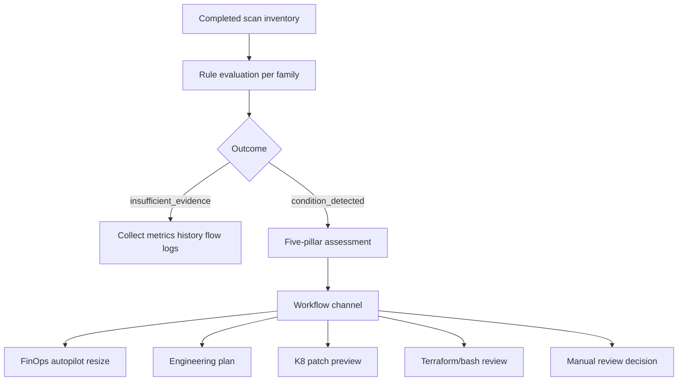

# Analysis rules master reference (all points considered)

CloudSaver evaluates **54 published catalog rules** across Azure, AWS, GCP, Kubernetes, and platform extensions. 
This document is the operator-facing view of **what each rule checks**, **what evidence must exist**, 
**which pillar it primarily supports**, and **which action path applies** after `condition_detected`.

Regenerate after catalog changes:

```bash
PYTHONPATH=. python3 scripts/generate_analysis_rules_master.py
```

Related: [RESOURCE_ANALYSIS_RULES.md](RESOURCE_ANALYSIS_RULES.md) (per resource type), 
[FINOPS_ANALYSIS_VERIFICATION.md](FINOPS_ANALYSIS_VERIFICATION.md), 
[FINOPS_RESIZE_METRICS.md](FINOPS_RESIZE_METRICS.md).

---

## How “best” analysis works here (all points considered)

Every rule evaluation records exactly one of **eight outcomes** — never silent approval:

`condition_detected` · `condition_not_detected` · `insufficient_evidence` · `not_applicable` · 
`disabled_by_policy` · `excluded_by_exception` · `unsupported_by_collector` · `evaluation_failed`

**Cross-cutting gates (always applied):**

| Dimension | Behavior |
| --- | --- |
| **Five pillars** | Each finding merges into cost, reliability, performance, security, operations checks in assessment (`app/assessment.py`). |
| **Protection** | Tags, locks, backup/replication, DR roles → `protected_reasons`; blocks destructive recommendations. |
| **Observation freshness** | Evaluations require observation within **24 hours** unless rule says otherwise. |
| **Telemetry contract** | 30-day / 5-minute series where used: **≥95% coverage**, no gap **>60 minutes**, no zero-fill. |
| **SLO / rightsizing** | VM/EC2/GCE/RDS/App Service rules use `slo_gate` — error budget, latency correlation, OOM/throttle guards. |
| **Financial overlap** | Same resource + multiple rules → opportunity groups; do not sum savings blindly. |
| **Automatic execution** | **`automatic_execution: false`** on all rule rows; actions are explicit APIs with human gates. |
| **Scoped workspaces** | Provider/scope keys filter scans, findings, and evaluations consistently. |



---

## Recommended production sets

| Set | Enable when | Rules (count) |
| --- | --- | --- |
| **FinOps compute resize** | Live metrics + identity connectors with `compute.resize` | 5 autopilot-mapped rightsizing rules |
| **Storage hygiene** | Snapshot/history collectors healthy | Unattached disk/EBS/GCP disk + performance/tuning rules |
| **Network cost** | Flow logs + routing verification wired | NAT bypass, AppGW/LB empty backend, idle IP rules |
| **Kubernetes efficiency** | Prometheus/AMP metrics on clusters | CPU/memory overrequest + PVC/service rules |
| **Full catalog** | Mature observability on all families | All **54** base rules + declarative JSON (default identity catalog) |

**Best single rule quality bar:** prefer rules that reached **`condition_detected`** with **sufficient telemetry** 
and **no `safety_blocks`** over legacy ARG-only findings without `rule_evaluations`.

---

## Complete rule catalog

| Tier | Provider | Category | rule_id | Display name | Pillar | Action channel | Evidence / condition summary | Parameters |
| --- | --- | --- | --- | --- | --- | --- | --- | --- |
| C — Network / architecture | aws | ai | `AWS_BEDROCK_PT_AND_SAGEMAKER_IDLE_ENDPOINT` | Bedrock provisioned throughput and idle SageMaker endpoint review | cost | `manual_assessment_only` | Idle inference endpoints or low PT utilization. | — |
| B — General manual assessment | aws | database | `AWS_DYNAMODB_BILLING_MODE_AND_UNUSED_GSI` | DynamoDB billing mode and unused GSI review | cost | `manual_assessment_only` | Low read/write utilization, low throttles, spiky traffic verified. | utilization_percent=18 |
| B — Capacity / tier review (manual) | aws | storage | `AWS_EBS_GP2_TO_GP3_AND_IOPS_TUNING` | EBS GP2 to GP3 and provisioned IOPS tuning review | cost | `manual_assessment_only` | IOPS/throughput P99 vs target disk headroom; no throttling. | headroom_percent=30 |
| A — FinOps resize (telemetry + SLO) | aws | compute | `AWS_EC2_GRAVITON_AND_SLO_RIGHTSIZING` | EC2 Graviton migration and SLO-bounded rightsizing review | cost | `finops_autopilot_resize` | Low CPU/memory P95 + SLO gate + target_compatible. | utilization_percent=15 |
| B — General manual assessment | aws | compute | `AWS_EC2_IMDSV2_NOT_REQUIRED` | EC2 instance metadata IMDSv2 not required review | security | `manual_assessment_only` | Live inventory shows HttpTokens != required on instance metadata options (IMDSv2 optional). | — |
| B — General manual assessment | aws | compute | `AWS_EC2_STOPPED_EBS_RESIDUAL` | Stopped EC2 instance residual EBS charge review | cost | `manual_assessment_only` | Stopped instance state history. | minimum_days=14 |
| B — General manual assessment | aws | database | `AWS_ELASTICACHE_GRAVITON_AND_VALKEY_UPGRADE` | ElastiCache Graviton and Valkey upgrade review | cost | `manual_assessment_only` | Low memory/CPU + target_compatible. | utilization_percent=25 |
| C — Network / architecture | aws | network | `AWS_ELB_ORPHANED_AND_INGRESS_CONSOLIDATION` | Orphaned load balancer and ingress consolidation review | cost | `manual_assessment_only` | Empty/orphan backend pattern (same as AppGW empty backend family). | minimum_days=7 |
| B — Import / bash review artifact | aws | database | `AWS_IDLE_RDS` | Idle or stopped RDS instance review | cost | `remediation_terraform_import` | Stopped DB or non-prod with near-zero connections/CPU. | minimum_days=7 |
| B — General manual assessment | aws | application | `AWS_LAMBDA_ARM64_AND_PROVISIONED_CONCURRENCY` | Lambda ARM64 and provisioned concurrency review | cost | `manual_assessment_only` | Low provisioned concurrency utilization + SLO + target_compatible. | utilization_percent=15 |
| C — Network / architecture | aws | network | `AWS_NAT_GW_ENDPOINT_BYPASS_AND_IDLE` | NAT gateway idle and VPC endpoint bypass review | cost | `manual_assessment_only` | routing_verified, flow coverage ≥95%, endpoint_eligible_bytes max > 0. | — |
| A — FinOps resize (telemetry + SLO) | aws | database | `AWS_RDS_AURORA_RIGHTSIZING_AND_GP3` | RDS / Aurora rightsizing and GP3 storage review | cost | `finops_autopilot_resize` | Low utilization + SLO gate + target_compatible. | utilization_percent=20 |
| B — General manual assessment | aws | storage | `AWS_S3_INTELLIGENT_TIERING_AND_MULTIPART_CLEANUP` | S3 Intelligent-Tiering and multipart cleanup review | cost | `manual_assessment_only` | Multipart abort policy gaps or lifecycle gaps. | — |
| B — Import / bash review artifact | aws | network | `AWS_UNASSOCIATED_EIP` | Unassociated Elastic IP address review | cost | `remediation_terraform_import` | Unassociated address state history (7d default). | minimum_days=7 |
| B — Import / bash review artifact | aws | storage | `AWS_UNATTACHED_EBS` | Unattached EBS volume retention review | cost | `remediation_terraform_import` | Unattached volume state + snapshot verification within 24h when required. | minimum_days=14 |
| B — General manual assessment | azure | compute | `AZURE_ACI_IDLE_LOW_UTILIZATION` | Container instance low utilization review | cost | `manual_assessment_only` | Low CPU/memory P95 + SLO gate + target_compatible. | utilization_percent=20 |
| A — FinOps resize (telemetry + SLO) | azure | compute | `AZURE_AKS_CLUSTER_UTILIZATION_REVIEW` | AKS cluster node utilization review | cost | `finops_autopilot_resize` | Cluster node CPU/memory P95 below thresholds. | utilization_percent=20 |
| B — General manual assessment | azure | ai | `AZURE_AI_FOUNDRY_PTU_VS_PAYG_ARBITRAGE` | Azure AI Foundry PTU vs pay-as-you-go review | cost | `manual_assessment_only` | PTU utilization review via ai_capacity.ptu_review. | utilization_percent=35 |
| B — Import / bash review artifact | azure | network | `AZURE_APPGW_EMPTY_OR_HIGH_AUTOSCALE_FLOOR` | Empty Application Gateway or high autoscale floor review | cost | `remediation_terraform_import` | dependencies_verified; request/healthy_target metrics; Empty state history (7d default). | minimum_days=7 |
| B — General manual assessment | azure | application | `AZURE_ASP_EMPTY_PAID_PLAN` | Empty paid App Service plan review | cost | `manual_assessment_only` | Paid SKU with zero apps/slots + Empty state history. | — |
| A — FinOps resize (telemetry + SLO) | azure | application | `AZURE_ASP_UNDERUTILIZED_SKU` | App Service capacity review | cost | `finops_autopilot_resize` | 30d CPU/memory P95 below thresholds; SLO gate pass. | — |
| B — General manual assessment | azure | database | `AZURE_COSMOSDB_MANUAL_RU_TO_AUTOSCALE` | Cosmos DB manual throughput vs autoscale review | cost | `manual_assessment_only` | Manual RU with low normalized RU consumption spread vs average. | utilization_percent=30 |
| B — General manual assessment | azure | storage | `AZURE_DISK_PROVISIONED_PERFORMANCE` | Disk recovery and provisioned performance review | cost | `manual_assessment_only` | Attached disk: IOPS/throughput series, target disk headroom, throttling flags; snapshot path for unattached. | — |
| B — Engineering zero-downtime review | azure | storage | `AZURE_DISK_UNATTACHED_RETENTION` | Retained unattached managed disk review | cost | `engineering_review_plan` | Continuous unattached disk state history for minimum_days; fresh observation (<24h). | minimum_days=14 |
| C — Network / architecture | azure | network | `AZURE_NAT_GATEWAY_SERVICE_ENDPOINT_BYPASS` | NAT gateway vs service endpoint routing review | cost | `manual_assessment_only` | routing_verified, flow_log_coverage_ratio ≥95%, endpoint_eligible_bytes max > 0. | — |
| B — General manual assessment | azure | network | `AZURE_PUBLIC_IP_ASSOCIATED_IDLE` | Associated public IP traffic review | cost | `manual_assessment_only` | Associated IP with ingress/egress byte series max ≤ maximum_bytes. | — |
| B — Import / bash review artifact | azure | network | `AZURE_PUBLIC_IP_UNASSOCIATED` | Unassociated public IP review | cost | `remediation_bash_review` | Association verified false + continuous Unassociated state for minimum_days. | minimum_days=7 |
| B — Capacity / tier review (manual) | azure | database | `AZURE_REDIS_UNDERUTILIZED_TIER_REVIEW` | Azure Cache for Redis tier utilization review | cost | `manual_assessment_only` | Memory/CPU P99 low, evictions low, target_compatible. | utilization_percent=25 |
| B — General manual assessment | azure | database | `AZURE_SQL_PG_IDLE_AND_NONPROD_HA_REVIEW` | Azure SQL / PostgreSQL idle and non-production HA review | cost | `manual_assessment_only` | Low CPU/memory utilization + SLO gate + target_compatible. | — |
| B — Engineering zero-downtime review | azure | storage | `AZURE_STORAGE_LIFECYCLE_AND_ORPHANED_VHD` | Storage lifecycle and orphaned VHD page blob review | cost | `engineering_review_plan` | Lifecycle verified without multipart abort rules, or orphaned VHD signals. | — |
| A — FinOps resize (telemetry + SLO) | azure | compute | `AZURE_VM_RIGHTSIZING_UTILIZATION` | Evidence-based VM rightsizing review | cost | `finops_autopilot_resize` | 30d CPU/memory P95 below thresholds; disk IOPS & network series; burst credits; SLO gate pass. | utilization_percent=15 |
| B — General manual assessment | azure | database | `AZURE_DATABASE_PUBLIC_NETWORK_REVIEW` | Database public network access review | cost | `manual_assessment_only` | publicly_accessible true on SQL/Postgres/MySQL/Synapse. | — |
| B — General manual assessment | azure | platform | `AZURE_KEYVAULT_LOW_ACTIVITY` | Key Vault low API activity review | cost | `manual_assessment_only` | ServiceApiHit total near zero over observation window. | utilization_percent=5 |
| C — Network / architecture | azure | network | `AZURE_LB_EMPTY_OR_IDLE_BACKEND` | Load balancer empty backend or idle traffic review | cost | `manual_assessment_only` | Empty backend / low DipAvailability and byte count pattern. | minimum_days=7 |
| B — General manual assessment | azure | application | `AZURE_LOGIC_WORKFLOW_IDLE` | Logic App idle workflow review | cost | `manual_assessment_only` | RunsStarted total near zero. | utilization_percent=5 |
| B — General manual assessment | azure | application | `AZURE_MESSAGING_IDLE_NAMESPACE` | Service Bus or Event Hubs idle namespace review | cost | `manual_assessment_only` | Incoming requests/messages and connections near zero. | utilization_percent=5 |
| C — Network / architecture | azure | network | `AZURE_NAT_GATEWAY_IDLE_LOW_TRAFFIC` | NAT gateway idle low traffic review | cost | `manual_assessment_only` | routing_verified; SNAT connections and bytes below thresholds. | — |
| B — General manual assessment | azure | database | `AZURE_REDIS_LEGACY_TLS_REVIEW` | Azure Cache for Redis legacy TLS review | cost | `manual_assessment_only` | tls_required false with minimum TLS below 1.2. | — |
| B — General manual assessment | azure | storage | `AZURE_STORAGE_PUBLIC_BLOB_ACCESS_REVIEW` | Storage account public blob access review | cost | `manual_assessment_only` | allow_blob_public_access true. | — |
| B — General manual assessment | azure | database | `AZURE_SYNAPSE_IDLE_WORKSPACE` | Synapse workspace idle compute review | cost | `manual_assessment_only` | SQL streaming / workspace activity metrics near zero. | utilization_percent=5 |
| A — FinOps resize (telemetry + SLO) | azure | compute | `AZURE_VMSS_LOW_UTILIZATION_REVIEW` | Virtual machine scale set utilization review | cost | `finops_autopilot_resize` | Scale set CPU/memory P95 below thresholds. | utilization_percent=20 |
| B — General manual assessment | azure | compute | `AZURE_VM_STOPPED_RESIDUAL_COST` | Stopped VM residual charge review | cost | `manual_assessment_only` | Power stopped/deallocated with duration history where applicable. | minimum_days=14 |
| B — General manual assessment | azure | application | `AZURE_WEB_APP_IDLE_LOW_REQUESTS` | Web app low request volume review | cost | `manual_assessment_only` | Running site with Requests total below threshold. | utilization_percent=5 |
| B — General manual assessment | gcp | database | `GCP_BIGQUERY_SLOT_AUTOSCALE_AND_STORAGE` | BigQuery slot autoscale and storage review | cost | `manual_assessment_only` | Low slot utilization + target_compatible + no commitment conflict. | utilization_percent=25 |
| B — General manual assessment | gcp | application | `GCP_CLOUDRUN_MIN_INSTANCE_AND_MEMORYSTORE` | Cloud Run min instances and Memorystore review | cost | `manual_assessment_only` | Zero requests with min instances > 0 on non-prod signals. | — |
| B — Capacity / tier review (manual) | gcp | database | `GCP_CLOUDSQL_ALLOYDB_RIGHTSIZING_AND_HA` | Cloud SQL / AlloyDB rightsizing and HA review | cost | `manual_assessment_only` | Low utilization + SLO gate + target_compatible. | utilization_percent=20 |
| C — Network / architecture | gcp | network | `GCP_CLOUD_NAT_PRIVATE_GOOGLE_ACCESS` | Cloud NAT vs Private Google Access routing review | cost | `manual_assessment_only` | routing_verified, flow coverage ≥95%, endpoint_eligible_bytes max > 0. | — |
| B — Capacity / tier review (manual) | gcp | storage | `GCP_DISK_HYPERDISK_IOPS_TUNING` | Persistent disk Hyperdisk IOPS tuning review | cost | `manual_assessment_only` | IOPS/throughput vs target headroom. | headroom_percent=30 |
| A — FinOps resize (telemetry + SLO) | gcp | compute | `GCP_GCE_AXION_AND_CUSTOM_RIGHTSIZING` | GCE Axion / custom machine rightsizing review | cost | `finops_autopilot_resize` | Low CPU/memory + SLO gate + target_compatible. | utilization_percent=15 |
| B — General manual assessment | gcp | compute | `GCP_GCE_STOPPED_DISK_TAX` | Stopped GCE instance persistent disk charge review | cost | `manual_assessment_only` | Stopped VM disk charge history. | minimum_days=14 |
| B — Import / bash review artifact | gcp | database | `GCP_IDLE_CLOUD_SQL` | Idle Cloud SQL instance review | cost | `remediation_terraform_import` | Aligned hours and zero max connections when present. | — |
| B — General manual assessment | gcp | network | `GCP_LB_EMPTY_BACKEND_FORWARDING_RULE` | Empty backend forwarding rule review | cost | `manual_assessment_only` | Empty backend forwarding rule pattern. | minimum_days=7 |
| B — Import / bash review artifact | gcp | network | `GCP_UNASSIGNED_ADDRESS` | Unassigned regional external IP review | cost | `remediation_terraform_import` | Unassigned address retention history. | minimum_days=7 |
| B — Import / bash review artifact | gcp | storage | `GCP_UNATTACHED_DISK` | Unattached persistent disk retention review | cost | `remediation_terraform_import` | Unattached disk + snapshot verification when required. | minimum_days=14 |
| C — Network / architecture | gcp | ai | `GCP_VERTEX_AI_IDLE_ENDPOINT_AND_REPLICA_FLOOR` | Vertex AI idle endpoint and replica floor review | cost | `manual_assessment_only` | Idle endpoint invocations or low replica floor utilization. | — |
| B — Kubernetes assessment | kubernetes | application | `K8S_ABANDONED_WORKLOAD_OR_NAMESPACE` | Zero-traffic workload or namespace review | operations | `manual_assessment_only` | Zero-traffic workload/namespace history. | — |
| A — K8 patch preview | kubernetes | compute | `K8S_CONTAINER_CPU_OVERREQUEST` | Container CPU request rightsizing review | cost | `kubernetes_patch_preview` | Mature workload CPU P95 vs request headroom; patch recommendation when detected. | — |
| A — K8 patch preview | kubernetes | compute | `K8S_CONTAINER_MEMORY_OVERREQUEST` | Container memory working-set rightsizing review | cost | `kubernetes_patch_preview` | Memory working-set P95 vs request; OOM guards. | — |
| B — Kubernetes assessment | kubernetes | compute | `K8S_CONTAINER_UNDERPROVISIONED_RISK` | Container throttling, OOM, and QoS reliability review | cost | `manual_assessment_only` | Throttling/OOM/restart telemetry (reliability, not downsizing). | — |
| B — Kubernetes assessment | kubernetes | compute | `K8S_DAEMONSET_CLUSTER_WIDE_OVERHEAD_TAX` | DaemonSet cluster-wide allocation overhead review | cost | `manual_assessment_only` | DaemonSet aggregate allocation overhead. | — |
| B — Kubernetes assessment | kubernetes | compute | `K8S_HPA_PDB_CONFLICT_OR_IDLE_FLOOR` | Horizontal Pod Autoscaler floor and PDB conflict review | cost | `manual_assessment_only` | HPA min replicas vs PDB constraints or idle floor. | — |
| B — Kubernetes assessment | kubernetes | compute | `K8S_NODE_POOL_FRAGMENTATION_WASTE` | Node pool capacity reservation slack review | cost | `manual_assessment_only` | Node allocatable vs requested slack. | — |
| B — Kubernetes assessment | kubernetes | network | `K8S_ORPHANED_LOADBALANCER_SERVICE` | LoadBalancer service with empty endpoints review | cost | `manual_assessment_only` | LoadBalancer service with empty endpoints. | — |
| B — Kubernetes assessment | kubernetes | storage | `K8S_PVC_UNMOUNTED_OR_LOW_OCCUPANCY` | Unmounted or low-occupancy PVC review | cost | `manual_assessment_only` | PVC mount status and occupancy. | — |
| B — Kubernetes assessment | kubernetes | compute | `K8S_STATEFULSET_SIZING_AND_VOLUME_TEMPLATE` | StatefulSet memory buffer and volume template review | reliability | `manual_assessment_only` | StatefulSet memory buffer and volume template sizing. | — |
| B — Platform policy (tags / declarative JSON) | platform | operations | `PLATFORM_DEFAULT_TAGS` | Default FinOps tag set review (platform) | operations | `manual_assessment_only` | Built-in platform check on inventory tags/labels (owner, cost center, environment). | — |
| B — Platform policy (tags / declarative JSON) | platform | operations | `PLATFORM_PROD_ENCRYPTION_EXPECTATION` | Production encryption expectation review (platform) | security | `manual_assessment_only` | Production-scoped resource with encryption_at_rest explicitly false in evidence. | — |
| B — General manual assessment | platform | operations | `WIZ_SECURITY_POSTURE` | Wiz open security issues (CSPM) | security | `manual_assessment_only` | Complete fresh history, telemetry, and target proof per family contract. | — |

---

## Worked examples (check → analyze → action)

### `AZURE_VM_RIGHTSIZING_UTILIZATION`

1. **Check:** Scan lists `Microsoft.Compute/virtualMachines` → metrics show 30d CPU P95 4%, memory P95 22%, disk/network series pass contract, `slo_gate` clear, no protection tags.
2. **Analyze & action:** `condition_detected` → assessment (cost + performance) → `finops_autopilot_resize` → `GET .../resize-metrics` eligible → `compute.resize` playbook `azure.vm.rightsize` with human approval.

### `AWS_NAT_GW_ENDPOINT_BYPASS_AND_IDLE`

1. **Check:** NAT gateway inventory row → flow logs prove ≥95% coverage, `routing_verified`, eligible bytes to S3/Dynamo via VPC endpoints > 0.
2. **Analyze & action:** `condition_detected` → manual_assessment_only — architect endpoint routing; **no** autopilot resize or Terraform import.

### `K8S_CONTAINER_CPU_OVERREQUEST`

1. **Check:** Deployment pod metrics: CPU P95 80m vs request 2000m over mature window; no throttling risk flags.
2. **Analyze & action:** `condition_detected` → `kubernetes_patch_preview` → YAML patch lowering requests; operator applies after dry-run.

### `AZURE_DISK_UNATTACHED_RETENTION`

1. **Check:** Managed disk unattached 21 days, snapshot verified, no legal-hold tags.
2. **Analyze & action:** `condition_detected` → `engineering_review_plan` for detach/delete sequencing (execution disabled until readiness gates pass).

### `AWS_UNATTACHED_EBS`

1. **Check:** Volume `available` 30 days, recent snapshot on file.
2. **Analyze & action:** `condition_detected` → `remediation_terraform_import` review package — operator confirms delete or attach; not auto-deleted.


---

## Legacy scan findings (Azure ARG — parallel to catalog)

These **`rule_id`** values may appear in `scan.findings` without catalog `rule_evaluations`:

| rule_id | Display name | Typical action |
| --- | --- | --- |
| `ORPHANED_DISK` | Unattached managed disk | Terraform import / bash review |
| `UNASSOCIATED_PUBLIC_IP` | Unassociated public IP | Terraform import / bash review |
| `ORPHANED_NIC` / `ORPHANED_NSG` | Orphan NIC/NSG | Bash + Terraform review |
| `IDLE_APP_GATEWAY` | Idle Application Gateway | Terraform import only |
| `STOPPED_VM` / `EMPTY_APP_SERVICE_PLAN` | Stopped VM / empty plan | Manual + catalog rules when live evidence exists |

Prefer **catalog outcomes** on inventory rows when both exist; legacy rows are review **signals**, not savings proof.

---

## Five-pillar rule catalog (API)

Analysis rules are grouped under the same five pillars as resource assessment: **Cost**, **Reliability**, **Performance**, **Security**, **Operations**.

| Endpoint | Purpose |
| --- | --- |
| `GET /api/v1/rules/catalog/by-pillar?provider=azure` | All Azure rules nested under each pillar (includes exact `resource_types` per rule) |
| `GET /api/v1/rules/catalog/azure-compute` | VM vs VMSS vs AKS vs ACI matrix with `by_pillar` per type |
| `GET /api/v1/rules/catalog` | Flat list; each item includes `pillar` and `resource_types` |

Source of truth: [`app/analysis_rule_catalog.py`](../app/analysis_rule_catalog.py) (`_AZURE_RULE_BINDINGS`). Registry evaluation imports this map so **standalone VMs** and **VM scale sets** never share the wrong rules.

### Azure compute analysis (VM ≠ VMSS)

| ARM type | Label | Typical rules |
| --- | --- | --- |
| `microsoft.compute/virtualmachines` | Virtual machine | Stopped residual cost (**cost**); rightsizing utilization (**performance**) |
| `microsoft.compute/virtualmachinescalesets` | Virtual machine scale set | Scale set utilization review (**performance**) only — no stopped-VM rule |
| `microsoft.containerservice/managedclusters` | AKS cluster | Cluster node utilization (**performance**) |
| `microsoft.containerinstance/containergroups` | Container instance | Low utilization (**performance**) |

