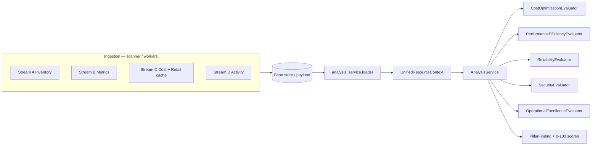

# Analysis Service

Standalone service (`analysis-service`, port **8004**) that evaluates **five Well-Architected pillars** from pre-ingested data only. It never calls cloud provider APIs during analysis.

## Architecture

## HTTP

| Method | Path | Body |
|--------|------|------|
| POST | `/api/v1/analysis/resources` | `{ "contexts": [ UnifiedResourceContext, ... ] }` |
| POST | `/api/v1/analysis/scan` | `{ "scan": { "inventory": [...], "timestamp": "..." } }` |

Gateway proxies the same paths when `ANALYSIS_SERVICE_URL` is set.

## Code layout

| Path | Role |
|------|------|
| `app/analysis_service/context.py` | `UnifiedResourceContext`, streams B–D snapshots |
| `app/analysis_service/loader.py` | Map scan inventory → context (no HTTP) |
| `app/analysis_service/service.py` | `AnalysisService.analyze_account` |
| `app/analysis_service/evaluators/*.py` | Deterministic pillar rules |
| `app/analysis_service/finding.py` | `PillarFinding`, `finding_id` hash |
| `services/analysis_service_app.py` | FastAPI factory |

## Tests

- `tests/test_analysis_service_pillars.py` — AWS/Azure/GCP fixtures, all 5 pillars
- `tests/test_analysis_service_http.py` — service health + authenticated POST

Run: `python3 -m pytest tests/test_analysis_service_pillars.py tests/test_analysis_service_http.py -q`

## Scan persistence

Every completed scan job now includes **`pillar_analysis`** (via `app/analysis_service/pipeline.attach_pillar_analysis` in `workers/tasks.run_scan_job`): account-level scores, per-resource findings, and deterministic `finding_id` values. Ingestion collectors populate `inventory[].evidence`; the loader joins Streams A–D into `UnifiedResourceContext` without live HTTP.

## Ingestion streams vs implementation

| Stream | Spec endpoint | CloudSaver ingestion today | Analysis consumption |
|--------|---------------|----------------------------|----------------------|
| **A** Inventory | ARG / Resource Explorer / Asset search | ARG REST, AWS/GCP describes (+ gaps: RE2, searchAllResources) | `loader.context_from_inventory_row` |
| **B** Metrics | CloudWatch / Monitor (+ batch) / Monitoring | Per-resource GET (Azure batch **catalog only**, client pending) | `metrics` summary + series in evidence |
| **C** Cost + retail | CM / CE / BQ + retail APIs | `billing_sync`, retail cache, scan billing merge | `cost` snapshot on context |
| **D** Activity | CloudTrail / Activity Log / Audit | `azure_live`, `aws_live`, `gcp_live` (partial) | `activity[]`, `drift_detected` |
| **E** Advisor | TA / Advisor / Recommender | Not collected | `advisor_signals[]` (optional) |

## Relation to legacy assessment

`app/assessment.py` and `app/resource_assessment.py` remain the **UI read path** for saved scans. The analysis service is the **decoupled evaluation engine** intended to replace ad-hoc pillar logic over time. Wire scan completion to POST `/api/v1/analysis/scan` as a follow-up task.
