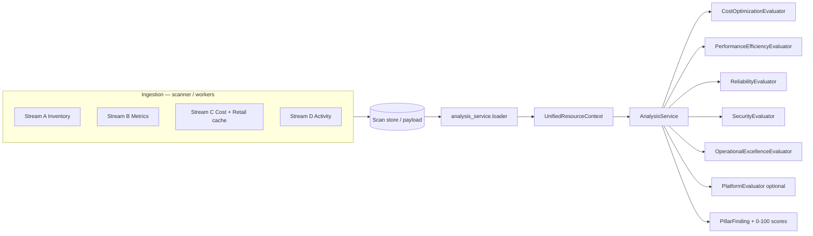

# Analysis Service

Standalone service (`analysis-service`, port **8004**) that evaluates **five Well-Architected pillars** from pre-ingested data only. It never calls cloud provider APIs during analysis.

Production scans also run the same engine **in-process** via `app/analysis_service/pipeline.py` (no HTTP hop required when the scanner worker has inventory + evidence loaded).

## Architecture

## HTTP

| Method | Path | Body |
|--------|------|------|
| POST | `/api/v1/analysis/resources` | `{ "contexts": [ UnifiedResourceContext, ... ] }` |
| POST | `/api/v1/analysis/scan` | `{ "scan": { "inventory": [...], "timestamp": "..." } }` |

Gateway proxies the same paths when `ANALYSIS_SERVICE_URL` is set.

### Persisted scan read APIs (scanner)

| Method | Path | Notes |
|--------|------|--------|
| GET | `/api/v1/scans/{scan_id}/pillar-analysis` | Full `pillar_analysis` block (404 if not computed) |
| GET | `/api/v1/scans/{scan_id}` | Summary includes `pillar_analysis` when present |
| GET | `/api/v1/resources/{provider}/{resource_id}` | Includes `pillar_scores` from persisted analysis when available |

Implemented in `app/pillar_analysis_api.py` and `app/resource_api.py`; gateway forwards `GET .../pillar-analysis`.

## Code layout

| Path | Role |
|------|------|
| `app/analysis_service/context.py` | `UnifiedResourceContext`, streams B–D snapshots |
| `app/analysis_service/loader.py` | Map scan inventory → context (no HTTP); **`activity_events`** preferred over legacy `state_history` |
| `app/analysis_service/billing_enrich.py` | Derive evaluator cost fields when FOCUS billing is merged onto evidence |
| `app/analysis_service/pipeline.py` | `run_pillar_analysis`, `attach_pillar_analysis` |
| `app/analysis_service/service.py` | `AnalysisService.analyze_account` |
| `app/analysis_service/evaluators/*.py` | Deterministic pillar rules + `platform.py` aggregator |
| `app/analysis_service/platform_rules.py` | Optional **platform** evaluators (`evaluate_platform`) |
| `app/analysis_service/finding.py` | `PillarFinding`, `finding_id` hash |
| `app/collectors/activity_events.py` | Normalized Stream D events appended by live collectors |
| `services/analysis_service_app.py` | FastAPI factory |

## Tests

- `tests/test_analysis_service_pillars.py` — AWS/Azure/GCP fixtures, all 5 pillars
- `tests/test_analysis_service_http.py` — service health + authenticated POST
- `tests/test_analysis_service_pipeline.py` — in-process attach on scan dict
- `tests/test_pillar_analysis_api.py` — persisted block on scan list/get + resource scores
- `tests/test_activity_events_normalization.py` — collector + loader Stream D
- `tests/test_analysis_billing_enrich.py` — cost spike / amortized fields on evidence
- `tests/test_azure_monitor_batch.py` — Monitor batch client (mocked HTTP)

Run full analysis-related suite:

`python3 -m pytest tests/test_analysis_service_pillars.py tests/test_analysis_service_http.py tests/test_analysis_service_pipeline.py tests/test_pillar_analysis_api.py tests/test_activity_events_normalization.py tests/test_analysis_billing_enrich.py tests/test_azure_monitor_batch.py -q`

## Scan persistence

Every completed scan job includes **`pillar_analysis`** before the job is marked complete:

1. **`materialize_scan_billing`** (when configured) merges FOCUS costs and runs **`enrich_inventory_billing_evidence`** on each row (`app/focus.py`).
2. **`attach_pillar_analysis(scan)`** runs **`AnalysisService`** over `loader.contexts_from_scan(scan)` and sets `scan['pillar_analysis']` (engine id, account pillar scores, per-resource scores/findings, `finding_count`).

Call sites:

- **Async jobs:** `workers/tasks.run_scan_job` (after `ScanSummary` validation, before `repository.complete_job`).
- **Sync scans:** `app/main.py` scan handler (after billing materialization, before `store.save` / `complete_scan`).

List/get scan responses preserve `pillar_analysis` via `app/scan_response.scan_for_api` and `ScanSummary.pillar_analysis` in `app/schemas.py`.

Ingestion collectors populate `inventory[].evidence` (metrics series, **`activity_events`**, billing keys); the loader joins Streams A–D into `UnifiedResourceContext` without live HTTP.

## Ingestion streams vs implementation

| Stream | Spec endpoint | CloudSaver ingestion today | Analysis consumption |
|--------|---------------|----------------------------|----------------------|
| **A** Inventory | ARG / Resource Explorer / Asset search | ARG REST; AWS/GCP describes — **gaps:** AWS Resource Explorer 2, GCP still **ListAssets** not `searchAllResources` | `loader.context_from_inventory_row` |
| **B** Metrics | CloudWatch / Monitor (+ batch) / Monitoring | Azure: **`prefetch_batch_metrics`** when ≥11 resources share sub+region+type, else per-resource GET (`azure_monitor_batch` + `azure_live.enrich`); AWS/GCP per-resource as before | `metrics` summary + series in evidence |
| **C** Cost + retail | CM / CE / BQ + retail APIs | `billing_sync`, retail cache, scan billing merge + **`billing_enrich`** on FOCUS attach | `cost` snapshot on context (`CostSnapshot`) |
| **D** Activity | CloudTrail / Activity Log / Audit | Normalized **`activity_events`** on AWS/Azure/GCP live paths; legacy `state_history` fallback in loader | `activity[]`, `drift_detected` (when present on evidence) |
| **E** Advisor | TA / Advisor / Recommender | **Optional** when `CLOUDSAVER_CLOUD_ADVISOR_ENABLED` (`app/collectors/cloud_advisor.py`) | `advisor_signals[]` optional |

## Platform-extensible analysis rules

Deployments can add **extra** `PillarFinding` rows without forking CloudSaver. These run **after** built-in evaluators and **affect pillar scores** (same scoring as core rules).

| Mechanism | Description |
|-----------|-------------|
| **`app/analysis_platform_hooks.py`** | If this module exists on `PYTHONPATH`, it may define `evaluate_platform(ctx: UnifiedResourceContext) -> list[PillarFinding]`. |
| **`CLOUDSAVER_ANALYSIS_PLATFORM_EVALUATORS`** | Comma-separated dotted import paths; each module must export **`evaluate_platform`** with the same signature. |
| **`register_platform_evaluator(fn)`** | In-process registration (tests or app startup code); see `app/analysis_service/platform_rules.py`. |
| **`CLOUDSAVER_ANALYSIS_PLATFORM_MAX_FINDINGS_PER_RESOURCE`** | Safety cap per resource (default **50**, max **500**); truncates with a log line if exceeded. |

**Implementation notes**

- Use **`deterministic_finding_id`** with a unique `rule_id` (prefix custom ids, e.g. `PLATFORM_*`) to avoid collisions with core rules.
- Evaluators must be **pure**: only read `UnifiedResourceContext` (built from scan inventory by `loader.py`); no live HTTP.
- **`finding_id`**, **`canonical_id`**, **`provider`**, **`region`**, and **`resource_type`** on each returned finding are **normalized** from the current context (platform code cannot attach findings to another resource).
- Duplicate **(pillar, rule_id)** pairs from platform code are **deduplicated** (highest **Severity** kept).
- Invalid dicts / failed validation are skipped with a warning log.
- Prefer packaging platform logic in a dedicated wheel or repo layer that ships `app/analysis_platform_hooks.py` on the image. Example starter: `examples/analysis_platform_hooks.example.py`.

**Also see:** `docs/spec/well_architected_overview.md` (rule catalog + extension story).

## Relation to legacy assessment

`app/assessment.py` and `app/resource_assessment.py` remain the **UI read path** for rule-based five-pillar views and `financial_balance`. **`pillar_analysis`** is the **deterministic analysis-service output** stored on each scan; resource detail exposes matching **`pillar_scores`** when the scan block exists. Converging the two read models over time is optional follow-up; new product surfaces should prefer persisted `pillar_analysis`.

## Completion note (`ec2f304`)

Through **`ec2f304`** on branch `cursor/fix-all-ingestion-analysis-083f`, Streams B (Azure batch), C (billing enrich), and D (`activity_events`), scan wiring, and API persistence are implemented. Remaining ingestion gaps for richer analysis inputs: **Stream E**, AWS **Resource Explorer**, GCP **`searchAllResources`**, and full Task 3 drift/baseline plumbing independent of activity normalization.
