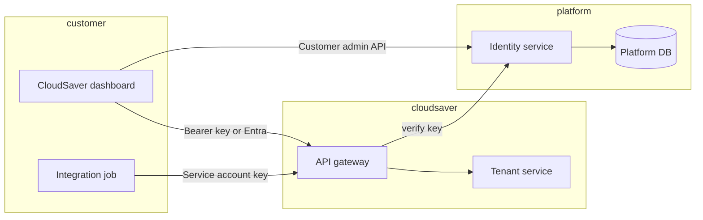

# Client-managed users and access keys

Detailed functional and architecture guide for giving a customer **one initial onboarding key**, then allowing its administrator to manage users and issue individual credentials with different levels of access.

**Status:** Implemented across identity-service (migration `i0007_client_access`), the platform portal, and CloudSaver. Customer sign-in uses a personal key with an email-derived identity; Entra/OIDC sign-in is still pending.

**Source baseline:** `ashokkondapuram/project`, commit `a59de5c2cc94c9fb20a9434308842d144dc96eaa`, inspected on Oct 23, 2026.

**Implemented:**

- **Identity:** single-use bootstrap keys (24 hours by default, 72 maximum), claim, user invite/suspend/reactivate, ownership transfer, workspace members, service accounts, delegated key issue/rotate/revoke, scope restrictions, customer audit and CSV export, and limits (25 service accounts, 20 invites a day). Verify returns `scope_restrictions`, `subject_type`, `subject_id`, `membership_version` and `customer_roles`, and rejects keys whose user or service account is suspended or removed.
- **Portal:** claim status badges and the **Issue onboarding key** dialog on the customer page.
- **CloudSaver:** gateway proxies under `/api/v1/customer/*`, the public `/api/v1/onboarding/claim`, the dashboard `/claim` page, the **Users & keys** settings tab, and scope-limited data filtering.

**Not yet implemented:** Entra/OIDC customer sign-in, SCIM provisioning, step-up authentication, invite and expiry notifications, capability-level permissions.

## Contents

- [Required customer experience](#required-customer-experience)
- [Current capabilities and gaps](#current-capabilities-and-gaps)
- [Terminology and ownership](#terminology-and-ownership)
- [First administrator onboarding](#first-administrator-onboarding)
- [Users, memberships, and service accounts](#users-memberships-and-service-accounts)
- [Access levels and permission model](#access-levels-and-permission-model)
- [Delegation and privilege-escalation prevention](#delegation-and-privilege-escalation-prevention)
- [Key issuance and delivery](#key-issuance-and-delivery)
- [Key lifecycle and session security](#key-lifecycle-and-session-security)
- [CloudSaver customer UI](#cloudsaver-customer-ui)
- [Platform Portal operator UI](#platform-portal-operator-ui)
- [Architecture and request authorization](#architecture-and-request-authorization)
- [Proposed service interfaces](#proposed-service-interfaces)
- [Audit, notifications, and reporting](#audit-notifications-and-reporting)
- [Limits, billing, and availability](#limits-billing-and-availability)
- [Operational scenarios and recovery](#operational-scenarios-and-recovery)
- [Delivery sequence and completion criteria](#delivery-sequence-and-completion-criteria)
- [Source references](#source-references)

## Required customer experience

The Platform operator creates the customer and its approved workspace boundaries, then provides one onboarding key to the designated client administrator. The operator does not need to create and distribute a separate credential for every employee.

Using that initial key, the designated administrator completes account setup, becomes the first named customer owner, and can:

1. Invite users to the customer's own account.
2. Assign each user to specific workspaces and approved access levels.
3. Authorize individual keys for those users, with narrower permissions, scope restrictions, and expiry where appropriate.
4. Create separately identified service accounts for integrations and scheduled jobs.
5. Rotate or revoke credentials, suspend users, remove workspace access, and inspect authorized audit history.

The initial key is not a shared team password. Every user's activity must be attributable to their own identity and, where a key is used, their own key.

**“One key provided to the client” means one initial credential delivered by the Platform.** It does not mean that all users share that credential or that the system permits only one active key forever. Additional individual keys are generated through the customer's authorized self-service workflow.

The recommended implementation treats the initial key as a single-use bootstrap credential. After setup, the owner uses a personal sign-in method and, if needed, a personal key created through self-service. The Platform does not have to distribute another root key.

## Current capabilities and gaps

| Area | Existing source behavior | Required extension |
| --- | --- | --- |
| Workspace key administration | Platform operator APIs support issue, list, update, rotate, and revoke | Customer-authorized user/key administration boundary |
| Roles | `TenantAdmin`, `BillingAdmin`, and `Viewer` | Explicit customer ownership, delegated user management, analysis/rule/automation capabilities, and workspace memberships |
| Key storage | Generated keys use random secrets with peppered HMAC verification; plaintext is returned on issue/rotate | Preserve this storage model while adding key ownership, purpose, and delegation metadata |
| Provider restrictions | All-provider or explicit provider grants, subject to configuration | Explicit customer-delegation bounds and safe default handling for newly added providers |
| Resource scope restrictions | Nonempty scope-level restrictions are rejected by the current grant builder | Implement actual scope authorization before exposing subscription/account/project restrictions in UI |
| User ownership of keys | Workspace key records carry names and issuer metadata | Bind each personal key to an active user and membership, and each automation key to a service account |
| Customer onboarding | Operator-created workspace keys | Atomic one-time customer claim and first-owner enrollment |
| Customer-managed invitations | No complete invitation/membership system found in the inspected identity service | Invitation, identity verification, membership activation, expiry, and revocation |
| Key verification | Internal identity verification and bounded caching exist | Include subject status, membership/policy version, fine-grained permissions, and revocation dependencies |
| Local legacy authentication | Local workspace keys grant the broad existing workspace role set | Do not use legacy local authentication for the delegated model or silently fall back to it |
| Admin access boundary | Existing Platform admin APIs require operator authorization | Do not expose those APIs to clients by relabeling them as customer endpoints |

The current `TenantAdmin` helper can satisfy other existing workspace role checks. It is not sufficiently granular by itself for the proposed delegation model. Introducing more role names without replacing or adapting server-side authorization would not implement the required access separation.

## Terminology and ownership

| Term | Meaning |
| --- | --- |
| Customer | The client organization; the root administrative boundary |
| Workspace | A CloudSaver environment belonging to that customer, identified by `tenant_id` in current APIs |
| Bootstrap key | Short-lived, one-time credential for claiming the pre-created customer account |
| User | A named human principal with a verified sign-in identity |
| Customer membership | The relationship giving a user an administrative or ordinary membership in a customer account |
| Workspace membership | The relationship assigning a user specific roles and resource scopes in one workspace |
| Personal access key | A credential owned by one user; never broader than that user's active authority |
| Service account | A non-human principal for a defined integration, with its own grants and credentials |
| Key envelope | The maximum permissions and scopes that one key may exercise |
| Delegation envelope | The permissions and scopes an administrator is explicitly allowed to assign to others |
| Session | A bounded authenticated browser context; it does not become a permanent copy of a user's original permissions |

A workspace is not a Microsoft Entra directory. Do not equate its `tenant_id` with an Entra `tid` unless an explicit validated mapping exists. A human identity should be bound by identity provider issuer and immutable subject, not just an email address or an unverified token field.

Users may belong to multiple workspaces. Every request must identify and authorize the selected workspace. A single key should be bound to one workspace in the first delivery to fit the current contract and reduce ambiguity. Managing users across a customer uses a separate authenticated customer-management session with explicit delegation authority.

## First administrator onboarding

### Platform preparation

1. Create the customer, its initial workspace, and allowed cloud scopes/resource access configuration.
2. Identify the intended first owner and record the approved recipient identity or verification destination in private identity storage.
3. Create one bootstrap key bound to that customer and intended onboarding purpose. Proposed default expiry: 24 hours.
4. Deliver the key through an approved secure handover mechanism. Do not place it in a URL query, application log, ticket body, or repository.

### Customer claim flow (proposed)

1. The recipient presents the bootstrap key to a dedicated **claim** endpoint or CloudSaver onboarding route (not the standard long-lived dashboard sign-in).
2. Identity validates: key active, purpose `bootstrap`, customer not yet claimed, workspace in `pending_claim` or equivalent state.
3. The user completes identity proof (Entra sign-in, email OTP, or operator-pre-registered subject—product choice per deployment).
4. In one transaction: mark customer claimed, create `customer_owner` membership, revoke or expire bootstrap key, emit audit events, increment policy versions used by verify.
5. Redirect the owner to customer administration (users, workspaces) or to the primary workspace dashboard with a normal session.

### Failure and abuse handling

- Expired or reused bootstrap keys return a generic invalid response; operators see detailed reason in audit.
- Claim attempts against an already-claimed customer do not reveal whether the customer exists.
- Rate-limit claim and verify paths per IP and per key id.

## Users, memberships, and service accounts

### Human users

- Stored in identity (not CloudSaver Postgres tenant tables).
- Fields: stable `user_id`, `idp_issuer`, `idp_subject`, display name, email (verified flag), status (`active`, `suspended`, `deleted`), `created_at`, `last_sign_in_at`.
- Email is a contact attribute, not the primary key.

### Customer membership

| Role (proposed) | Capabilities |
| --- | --- |
| `CustomerOwner` | Full customer administration, billing visibility per policy, can transfer ownership |
| `CustomerAdmin` | Manage users, service accounts, and workspace assignments within delegation envelope |
| `CustomerAuditor` | Read-only membership, key metadata, and audit exports |

Exactly one active `CustomerOwner` per customer in v1 of this spec; transfer requires step-up authentication and audit.

### Workspace membership

- Links `user_id` + `tenant_id` + workspace roles (`TenantAdmin`, `BillingAdmin`, `Viewer`, and future fine-grained flags).
- Optional resource scope subset (subscriptions, AWS accounts, GCP projects, clusters) once enforcement exists server-side.
- Version field for optimistic concurrency on membership changes.

### Service accounts

- Non-human principal with `service_account_id`, customer id, name, description, status.
- Keys issued to service accounts carry `subject_type: service_account` and never inherit a human's session.
- Service accounts cannot invite users or change memberships unless explicitly granted a narrow automation role (default: deny).

## Access levels and permission model

### Layered evaluation (proposed)

Every CloudSaver API call resolves authorization in order:

1. **Authentication** — Valid Entra token, personal key, or service-account key.
2. **Subject status** — User or service account not suspended; customer not deleted.
3. **Workspace context** — `tenant_id` matches membership or key binding.
4. **Workspace membership roles** — Map to existing CloudSaver `require_workspace_role` checks where possible.
5. **Key envelope** (key auth only) — Roles, providers, scope restrictions ⊆ membership envelope.
6. **Plan entitlements** — Commercial limits from verify `plan` block (unchanged contract).
7. **Route policy** — Sensitive routes (GitOps, AI batch, billing upload) require explicit capability flags.

### Mapping to today's roles

| Today | Proposed usage |
| --- | --- |
| `TenantAdmin` | Workspace configuration, scans, settings, resource AI batches |
| `BillingAdmin` | Plan change requests, billing evidence (where enabled) |
| `Viewer` | Read scans, resources, assessments |

New capabilities (user administration, key issuance for others) are **not** implied by `TenantAdmin` until explicitly added to the delegation matrix and enforced in identity + gateway.

### Fine-grained capabilities (future)

Represent as a stable capability set in verify grants, for example: `users.invite`, `keys.issue`, `keys.revoke`, `scopes.edit`, `automation.manage`. Workspace roles become bundles of capabilities; keys may hold a subset.

## Delegation and privilege-escalation prevention

Rules:

1. An administrator may assign only roles and scopes **strictly inside** their delegation envelope.
2. A key cannot be issued with broader roles than the issuer's membership for that workspace.
3. Bootstrap keys cannot issue other keys or assign `CustomerOwner` after claim.
4. Operators use separate `PlatformOperator` identity; customer admins never receive operator routes.
5. Membership and key changes bump `membership_version` / `policy_version`; verify returns current versions; CloudSaver evicts cache on mismatch events.

Escalation attempts return `403` with a stable, non-leaky message: "You don't have permission to make this change."

## Key issuance and delivery

### Operator-issued workspace keys (today)

Platform Portal → identity `POST /admin/v1/workspaces/{tenant_id}/keys` with roles, provider mode, expiry. Secret returned once in response body.

### Customer-issued keys (proposed)

New customer API surface (example prefix `/customer/v1/`), authenticated by Entra session or customer-management token:

- `POST .../workspaces/{tenant_id}/keys` — issue personal or service-account key within envelope.
- Payload: `name`, `roles`, `all_providers` / `allowed_providers`, `expires_at`, optional `scope_restrictions` when implemented, `subject_user_id` or `service_account_id`.

Delivery rules:

- Plaintext secret shown once in UI modal; optional copy-to-clipboard with timeout; never emailed by default.
- Optional operator-assisted delivery remains platform-only with separate audit category.

### Scope restrictions (prerequisite)

Before UI advertises subscription/account restrictions, identity must:

1. Persist restrictions on the key row.
2. Include effective restrictions in verify grant.
3. CloudSaver must enforce restrictions in `narrow()` / route handlers for mutating and read paths.

Today `_grant_fields` rejects nonempty `scope_restrictions`; verify always returns `scope_restrictions: null`.

## Key lifecycle and session security

| Event | Behavior |
| --- | --- |
| Issue | Random secret, peppered digest, `key_id` prefix, expiry required |
| Rotate | Overlap window; old key `rotating_out` until `rotates_out_at` |
| Revoke | Immediate invalidation; event for cache eviction |
| Expiry | Same user-facing message as revoke (existing CloudSaver copy) |
| Last used | Update `last_used_at` / IP on verify (throttled writes) |

Sessions (browser):

- Short-lived access token; refresh via Entra only.
- Step-up authentication for revoke-all, ownership transfer, and bulk key creation.
- Dashboard memory-only credential storage policy unchanged.

Bootstrap keys:

- Maximum lifetime 24–72 hours (configurable).
- Single successful claim consumes the key.
- No rotate on bootstrap keys—issue a new bootstrap from operator if claim fails.

## CloudSaver customer UI

Proposed surfaces (dashboard), gated by membership:

| Area | Viewer | Workspace admin | Customer admin |
| --- | --- | --- | --- |
| Sign-in | Key or Entra | Key or Entra | Entra preferred after onboarding |
| Settings → Access | — | View own keys (future) | Manage workspace members (future) |
| Settings → API keys | — | Create/revoke own keys | Issue keys for members/service accounts |
| Audit | — | Workspace activity (future) | Customer audit export |

Copy follows [UX writing standards](ENVIRONMENT.md): sentence case, actionable errors, no blame.

First delivery does not require rebuilding the entire dashboard; a minimal **Access** settings tab plus claim landing page is sufficient for MVP.

## Platform Portal operator UI

Operators retain:

- Customer and workspace CRUD, cloud scope configuration, resource access tests.
- Bootstrap key issuance with purpose flag and short expiry.
- Break-glass revoke-all for a workspace.
- Visibility into customer claim status and membership counts (no plaintext secrets).

Operators do **not** routinely issue per-employee keys once customer self-service is enabled.

## Architecture and request authorization

- CloudSaver never stores key secrets; only identity verifies keys ([identity v1 contract](../platform/contracts/identity-v1.md)).
- Customer admin APIs live on identity (or a dedicated BFF) with Entra session auth—not portal operator tokens.
- Directory projection continues to supply workspace scopes; membership changes trigger `entitlements_changed` / custom events.

Auth modes:

| Mode | This spec |
| --- | --- |
| `workspace` + identity verify | Target production path for keys |
| Local `CLOUDSAVER_TENANTS` digest | Legacy; must not back delegated admin |
| `entra` | Primary for humans; keys for automation |

## Proposed service interfaces

### Identity — internal (extend verify grant)

Add optional fields on valid verify response (versioned, backward compatible):

- `subject_type`: `user` | `service_account` | `bootstrap`
- `subject_id`: uuid
- `membership_version`: integer
- `capabilities`: string array (when fine-grained model ships)
- `scope_restrictions`: structured object when enforced

### Identity — customer (new)

| Method | Path | Purpose |
| --- | --- | --- |
| POST | `/customer/v1/claim` | Bootstrap claim + owner enrollment |
| GET | `/customer/v1/users` | List users |
| POST | `/customer/v1/users/invite` | Invite by email |
| POST | `/customer/v1/users/{id}/suspend` | Suspend user |
| GET | `/customer/v1/workspaces/{tenant_id}/members` | List memberships |
| PUT | `/customer/v1/workspaces/{tenant_id}/members/{user_id}` | Set roles/scopes |
| POST | `/customer/v1/workspaces/{tenant_id}/keys` | Issue key (delegated) |
| POST | `/customer/v1/service-accounts` | Create service account |

All mutations require `CustomerAdmin` or `CustomerOwner` with step-up where noted.

### CloudSaver — gateway

- No new key storage endpoints required for MVP if all issuance stays on identity.
- Optional `GET /api/v1/me/memberships` when dashboard lists workspaces for Entra users.

### Portal — operator (extend)

- Bootstrap purpose on issue-key form.
- Customer `claim_status`: `pending`, `claimed`.

## Audit, notifications, and reporting

Audit events (identity `audit` stream), minimum:

- `bootstrap_issued`, `customer_claimed`, `user_invited`, `membership_changed`, `key_issued`, `key_revoked`, `key_rotated`, `service_account_created`, `ownership_transferred`.

Each event: actor subject, customer id, workspace id (if any), target ids, request id, no secrets.

Notifications (optional phase):

- Email to existing owners when a new admin is invited or a service account key is issued.
- Webhook to customer SIEM with signed payloads.

Reporting:

- CSV export of keys (metadata only), memberships, and sign-in failures per customer.

## Limits, billing, and availability

Reuse platform catalog limits where they exist:

- `max_active_keys_per_workspace`
- `max_key_lifetime_days`
- Plan `billing_state` and `issuance_blocked` for key creation (see [platform billing](PLATFORM_BILLING.md))

Additional proposed limits:

- Max invites per day per customer.
- Max service accounts per customer.
- Bootstrap keys per customer: 1 active.

Availability: customer admin APIs share identity SLO; verify path remains fail-closed on identity outage (`503` on CloudSaver).

## Operational scenarios and recovery

| Scenario | Response |
| --- | --- |
| Owner locked out | Operator verifies out-of-band, issues new bootstrap or performs break-glass owner assignment with ticket |
| Compromised key | Revoke key; optional revoke-all; rotate sibling keys |
| Compromised owner account | Suspend user; revoke keys bound to subject; transfer ownership |
| Stale directory | CloudSaver returns "still being set up"; tenant projector catches up |
| Wrong workspace on key | Key is workspace-bound; verify returns single `tenant_id` |

## Delivery sequence and completion criteria

### Phase 1 — Foundation

- Customer, user, membership, and service account tables in platform DB.
- Bootstrap claim API and operator bootstrap issuance.
- Verify grant includes `subject_id` and `membership_version`.
- **Done when:** claim flow works in staging; bootstrap cannot be reused; audit complete.

### Phase 2 — Delegated key administration

- Customer APIs for invite, membership, delegated key issue/revoke.
- Envelope checks on issue; no scope UI until enforcement lands.
- **Done when:** customer admin can issue Viewer key for user without operator; escalation tests pass.

### Phase 3 — Scope restrictions

- Persist and enforce `scope_restrictions` in verify + CloudSaver `narrow()`.
- **Done when:** integration test proves key cannot read out-of-scope subscription.

### Phase 4 — Dashboard and polish

- Claim page, Access settings, audit views.
- Step-up on sensitive actions.
- **Done when:** UX review passes; axe checks on new pages.

### Phase 5 — Enterprise identity

- Entra as primary human sign-in; optional SCIM (out of scope unless specified later).

**Program completion:** All acceptance criteria in phases 1–4 met; operators document runbooks; legacy local admin path disabled in production configurations.

## Source references

| Topic | Path |
| --- | --- |
| Identity verify contract | [`platform/contracts/identity-v1.md`](../platform/contracts/identity-v1.md) |
| Key issue/rotate/revoke | [`platform/identity/service.py`](../platform/identity/service.py), [`platform/identity/app.py`](../platform/identity/app.py) |
| Role normalization | [`platform/identity/domain.py`](../platform/identity/domain.py) |
| CloudSaver auth and roles | [`app/auth.py`](../app/auth.py) |
| Identity client verify | [`app/identity_client.py`](../app/identity_client.py) |
| Operator onboarding today | [`README.md`](../README.md) |
| Entra mode boundaries | [`README.md`](../README.md#entra-authentication) |
| Platform billing and key issuance policy | [`docs/PLATFORM_BILLING.md`](PLATFORM_BILLING.md) |
| Related product roadmap | [`docs/RESOURCE_ANALYSIS_AND_PORTAL_ROADMAP.md`](RESOURCE_ANALYSIS_AND_PORTAL_ROADMAP.md) |
