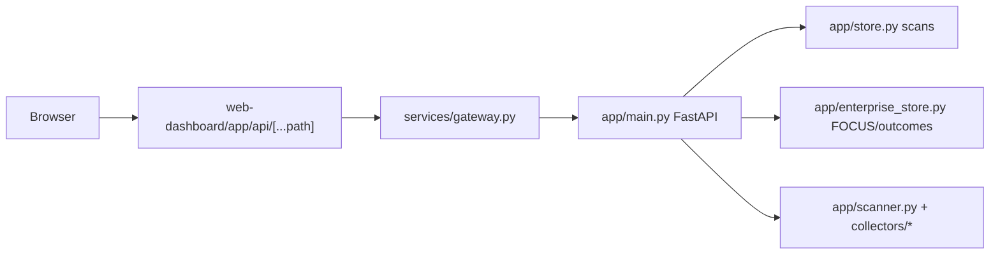

# CloudSaver codebase execution map

**Purpose:** One place to see what runs, what calls what, and what to delete instead of maintaining twice.  
**Version:** 1.8.1 tree · Nov 2026 · branch `cursor/retail-cost-consistency-083f`

---

## 1. Runtime topology (what executes)

| Process | Entry | Role |
|--------|--------|------|
| **Dashboard** | `web-dashboard/` (Next.js) | UI; proxies allowlisted `/api/v1/*` to gateway |
| **API gateway** | `services/gateway.py` | Rate limit, auth forward, route proxy to scanner/agent |
| **Scanner (core API)** | `app/main.py` → FastAPI | Scans, resources, FinOps, outcomes, engineering, GitOps |
| **Agent gateway** | `services/agent_gateway.py` | Agent task HTTP surface |
| **Agent worker** | `agent-worker/` (Node/TS) | Executes approved plans against Azure/AWS APIs |
| **Platform identity** | `platform/identity/service.py` | Keys, tenants, billing entitlements, UI themes |
| **Platform portal** | `platform/portal/` | Operator console (workspaces, keys, billing) |
| **Celery workers** | `workers/*.py` | Billing sync, delivery, drift, governance monitor, observability sync |
| **Local stack** | `compose.yaml` + `platform/compose.yaml` | Postgres, Redis, all services above |

**Boot:** `./start.sh` → builds images, runs migrations, starts compose services.

---

## 2. Request path (dashboard → data)

**Auth:** `app/auth.py` — workspace key or Entra; roles `TenantAdmin`, `BillingAdmin`, `Viewer`.  
**Route policy:** `app/route_inventory.py` (classification per path); tests in `tests/test_route_inventory.py`.

---

## 3. Scan pipeline (primary write path)

Triggered by `POST /api/v1/scans` or `POST /api/v1/scans/multi-cloud` in `app/main.py`.

| Step | Module | Executes |
|------|--------|----------|
| 1 | `app/scanner.py` | Resource Graph inventory + finding rules (`scan_live`) |
| 2 | `app/collectors/azure_arm_detail.py` | ARM **JSON GET** per `microsoft.*` row |
| 3 | `app/collectors/azure_storage_policy.py` | Storage management policy sub-resource |
| 4 | `app/collectors/azure_live.py` | Monitor metrics, activity log, guards (optional) |
| 5 | `app/azure_pricing_evidence.py` + `app/pricing.py` | Retail Prices API (JSON) + attribution |
| 6 | `app/multicloud_rules.py` + `app/analysis_rules.py` | Rule evaluations → findings |
| 7 | `app/dependencies.py`, `app/pricing.py` | Opportunity groups, totals |
| 8 | `app/store.py` | Persist scan JSON + `waste_finding_evidence` |
| 9 | `app/typed_resources/persist.py` | Relational rows for 5 Azure types (PG) |
| 10 | `app/scan_billing.py` | Azure Cost Management import at scan complete |

**Read path (resources UI):** `app/resource_api.py` → `app/resource_assessment.py` merges findings + inventory → five-pillar assessment + `financial_balance`.

---

## 4. Azure JSON & cost (live fetch)

| Module | Responsibility |
|--------|----------------|
| `app/azure_rest_catalog.py` | Documented REST operations (ARM, CM query, retail, provider metadata) |
| `app/azure_json_profile.py` | **Single module:** financial windows + `fetch_azure_resource_profile()` (ARM + CM + retail + booked savings) |
| `app/azure_resource_registry.py` | Pinned api-versions + `normalize_arm_body` for 15 types |
| `app/collectors/billing_sync.py` | Cost Management **JSON POST** (`azure_rows`, `azure_resource_rows`) |
| `app/financial_balance.py` | Pure math: billed vs retail, waste, commitment benefit |
| `app/finops_api.py` | HTTP: `/finops/azure-resource-costs`, `/finops/azure-rest-catalog`, billing sync |

**Do not re-add** a separate `azure_resource_finops.py` — logic lives in `azure_json_profile.py`.

---

## 5. Directory map (code that matters)

### `app/` — scanner service (Python)

| Area | Files | Executes |
|------|-------|----------|
| **Core** | `main.py`, `store.py`, `auth.py`, `schemas.py`, `runtime.py` | HTTP app, scan CRUD, auth |
| **Scan** | `scanner.py`, `multi_cloud.py`, `scan_progress.py`, `scan_billing.py`, `scan_response.py` | Cloud collection |
| **Resources** | `resource_api.py`, `resource_assessment.py`, `resource_action_items/`, `assessment.py` | `/resources` API + deterministic **action_items** (by category module) |
| **Azure** | `azure_*`, `collectors/azure_*`, `azure_pricing_evidence.py` | ARM, live evidence, pricing |
| **FinOps** | `finops_api.py`, `focus.py`, `billing_jobs.py`, `commitment_*`, `finops_autopilot_api.py` | Billing FOCUS, sync jobs |
| **Outcomes** | `outcome_api.py`, `outcome_store.py`, `outcome_evidence.py`, `outcome_anomalies.py` | Savings cases, reconcile |
| **Engineering** | `engineering/*` | Workloads, plans, zero-downtime reviews |
| **Control plane** | `control_plane/*`, `control_plane_api.py`, `agent_store.py` | Agent tasks, plans |
| **Drift / GitOps** | `drift/*`, `gitops_api.py`, `agent_gitops_sync.py` | Ingress, PR workflows |
| **AI** | `ai_advisory.py`, `foundry*.py`, `inference_ledger.py` | External model calls |
| **Rules** | `analysis_rules.py`, `multicloud_rules.py`, `effective_rules.py`, `kubernetes_rules.py` | Finding + inventory rules |

### `app/collectors/` — provider I/O

| File | JSON/HTTP target |
|------|------------------|
| `billing_sync.py` | Azure CM, AWS CE/Athena, GCP BigQuery |
| `azure_arm_detail.py` | ARM resource GET |
| `azure_live.py` | Monitor, Activity Log, locks, backup |
| `commitments.py` | Reservations, savings plans |
| `azure_endpoint.py` | URL validation (`management.azure.com`) |
| `cloud_http.py` (parent `app/`) | Shared `JSONReader` for GET |

### `app/typed_resources/`

| File | Executes |
|------|----------|
| `azure_schemas.py` | Table specs + cost column mapping |
| `persist.py` | Insert after scan save |
| `costs.py` | Load FOCUS charges into typed rows |

### `services/`

| File | Executes |
|------|----------|
| `gateway.py` | Public API edge |
| `agent_gateway.py` | Agent routes |

### `workers/`

| File | Executes |
|------|----------|
| `billing_sync.py` | Scheduled FOCUS import |
| `delivery_worker.py` | Notifications |
| `event_drift_worker.py` | Drift processing |
| `dispatcher.py`, `outbox_dispatcher.py` | Queue dispatch |

### `web-dashboard/`

| Path | Executes |
|------|----------|
| `app/` | Next routes (`/resources`, `/outcomes`, …) |
| `components/` | Workspace UI, resource drawer, FinOps panels |
| `lib/` | API client, resource types, finops helpers |
| `app/api/[...path]/route.ts` | **Allowlist** of proxied backend paths |

### `platform/`

| Path | Executes |
|------|----------|
| `identity/` | Tenant DB, keys, entitlements |
| `portal/` | Operator UI |

### `agent-worker/`

| Path | Executes |
|------|----------|
| `src/connectors.ts` | Azure/AWS mutations (approved tasks only) |

### `tests/`

Mirror `app/` domains; **`tests/test_route_inventory.py`** guards API surface.

---

## 6. Redundancy matrix (consolidate — do not maintain legacy)

| Issue | Locations | Action |
|-------|-----------|--------|
| ~~Azure finops split~~ | ~~`azure_resource_finops.py`~~ | **Removed** — use `azure_json_profile.py` only |
| ARM api-version | `azure_resource_registry` (`api_version_for_arm_resource_id`) | **Done** — drift operational fetch uses catalog resolver |
| UI theme presets | `app/ui_theme.py`, `platform/identity/ui_theme.py` | **Keep both** (separate deployables); change presets in both or extract shared package later |
| Rule evaluation | `resource_catalog` + `kubernetes_rules` via `multicloud_rules` | **Done** — Azure evidence contracts + bounds live in `resource_catalog`; `parameters()` delegates to `validate_rule_parameters` |
| Running inventory | `store.running_inventory_page` | **Done** — legacy in-memory page removed; `./start.sh` uses Postgres |
| Synthetic scans | `data_origin=legacy_synthetic` in `store.py`, UI guards | **Demo/e2e only** — do not extend; remove feature when e2e uses live fixtures only |
| Docs sprawl | `docs/archive/*` | **Done** — not linked from root README; use `docs/features/` + this map |
| V2 scaffolds | `causal_topology_simulator.py`, autopilot modules | Mark **non-production** in `docs/features/v2-scaffolds.md`; no new product deps |

---

## 7. Legacy retirement checklist (no new legacy code)

1. **Scans:** Only persist `data_origin` live (`completed` / `running`); stop seeding `legacy_synthetic` except explicit test fixtures.
2. **Rules:** One evaluation path (`resource_catalog` + K8s); keep platform `identity.analysis.contracts` aligned with `AZURE_EVIDENCE_CONTRACT_IDS` bounds.
3. **ARM versions:** One resolver (`azure_resource_registry.api_version_for_arm_resource_id` / `resolve_arm_api_version`).
4. **Azure cost:** One profile builder (`fetch_azure_resource_profile`); clients consume JSON only.
5. **Inventory paging:** `running_inventory_page` on the scan store (Postgres in `./start.sh`; SQLite test store implements the same contract).
6. **Documentation:** Feature truth in `docs/features/`; archived historical notes under `docs/archive/` (not linked from README).

---

## 8. API surfaces by product area

| UI route | Router module | Prefix |
|----------|---------------|--------|
| `/resources` | `resource_api.py` | `/api/v1/scans/.../resources` |
| `/allocation` | `finops_api.py`, `v150_analysis.py` | `/api/v1/finops`, `/api/v1/allocation` |
| `/outcomes` | `outcome_api.py` | `/api/v1/outcomes` |
| `/governance` | `governance_api.py` | `/api/v1/governance` |
| `/agents` | `control_plane_api.py` | `/api/v1/control-plane`, `/api/v1/agents` |
| `/workloads` | `engineering/api.py` | `/api/v1/engineering` |
| Settings | `settings_api.py` | `/api/v1/settings` |

Full path list: `docs/API_ROUTE_REGISTER.md` (generated from `route_inventory.py`).

---

## 9. Configuration that gates execution

| Variable | Gates |
|----------|--------|
| `CLOUDSAVER_BILLING_CONNECTORS` | Azure/AWS/GCP billing sync |
| `CLOUDSAVER_AZURE_ARM_DETAIL_ENABLED` | ARM JSON enrichment on scan |
| `CLOUDSAVER_LIVE_EVIDENCE_ENABLED` | Monitor / activity log pass |
| `CLOUDSAVER_DATABASE_URL` | Postgres vs SQLite (`store` capabilities) |
| `CLOUDSAVER_TENANT_REGISTRY` | Local tenants vs identity service |

See `docs/DEPLOYMENT_ENVIRONMENT.md` for the full list.

---

## 10. Where to change what (quick index)

| You want to… | Edit |
|--------------|------|
| Add Azure REST operation | `azure_rest_catalog.py` + `azure_json_profile.py` |
| Add ARM resource type | `azure_resource_registry._CATALOG` + optional `typed_resources/azure_schemas.py` |
| Change scan steps | `scanner.py`, `main.py` scan handler |
| Change resource drawer costs | `web-dashboard/components/resources/ResourceDrawer.tsx` |
| Add API route | Feature `*_api.py`, `route_inventory.py`, `gateway.py`, dashboard `route.ts` allowlist |
| Map UI tab → API | `docs/UI_API_MAP.md` |
| Smoke-test workspace APIs (local/product dev) | `scripts/audit_workspace_api.py` |
| Billing import | `collectors/billing_sync.py`, `workers/billing_sync.py` |

---

*Maintainers: update this file when you add a new long-running process, router, or provider collector. Do not duplicate execution narratives in other README fragments.*
