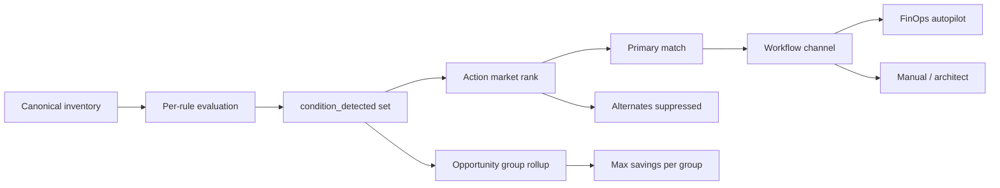

# Rule matching strategy (industry-grade / IBM Turbonomic alignment)

CloudSaver treats **rule evaluation** and **rule matching** as separate problems:

1. **Evaluation** — for each `(resource, rule_id)` pair, emit one of eight outcomes with full evidence (`evaluate_inventory`).
2. **Matching** — when several rules reach `condition_detected` on the same resource, pick **one primary action** and list **alternates** without double-counting savings (`app/rule_match_strategy.py`).
3. **Conflict surfacing** — per-resource reconciliation drift and finding/evaluation mismatches (`app/rule_detail.py` → `rule_conflicts`, exposed on resource detail as `rule_matches` / `rule_conflicts`).

This document is the operator and architect reference for that second layer, aligned with how **IBM Turbonomic** (Application Resource Management) selects among competing actions.

Regenerate cross-links after catalog changes via [ANALYSIS_RULES_MASTER.md](ANALYSIS_RULES_MASTER.md).

---

## What Turbonomic optimizes (and what we mirror)

| Turbonomic concept | CloudSaver equivalent |
| --- | --- |
| **Supply chain** (app → VM → disk → network) | Verified `dependency_refs` + `group_opportunities()` workload groups (`app/dependencies.py`) |
| **Action market** (many actions, one winner) | `resolve_resource_matches()` primary + `alternate_matches` |
| **Action types** (Buy, Move, Resize, Scale, Suspend, Delete, Configure) | `ActionClass` on each catalog rule (`rule_match_strategy.py`) |
| **Policies / automation modes** | Workspace rule policies; **`automatic_execution: false`** everywhere |
| **Performance assurance** | `slo_gate`, `safety_blocks`, five-pillar assessment |
| **Data health / confidence** | Telemetry contract + `match_confidence` (`high` / `medium` / `low` / `blocked`) |
| **Avoid double counting** | `opportunity_group_id` + `opportunity_totals()` max per group (`app/pricing.py`) |
| **Plan conflicts** | Control-plane `detect_conflicts()` for exclusive targets / SKU contention |

Turbonomic often **executes** the winning action under policy. CloudSaver **never auto-executes** catalog rules; the matching strategy still matters for UI ordering, agent playbooks, and FinOps totals.

---

## End-to-end flow



---

## Matching algorithm (v1.0.0)

Implemented in `resolve_resource_matches()` / `resolve_scan_matches()`.

### Step 1 — Candidate set

Only evaluations with `outcome == condition_detected` on the same `resource_id` enter the market.

### Step 2 — Sort key (lower wins)

| Order | Key | Rationale |
| --- | --- | --- |
| 1 | **Family rule order** | Order in `FAMILIES` tuple — stopped before rightsizing, unattached before tuning (Turbonomic state wins over utilization) |
| 2 | **Match confidence** | Protection blocks deprioritized; complete FinOps/K8 evidence scores higher among peers |
| 3 | **Workflow channel** | FinOps autopilot → K8 patch → engineering → Terraform/bash → manual |
| 4 | **Action class** | Scale → Resize → Configure → Suspend → Move → Architect → Delete |
| 5 | **`rule_id`** | Stable tie-break |

### Step 3 — Primary + alternates

- **Primary** — first row after sort; exposed as `primary_match` with `action_class`, `display_channel`, `match_confidence`.
- **Alternates** — remaining rows with `suppressed_reason: lower_rank_in_action_market`.

### Step 4 — Financial overlap (separate from primary pick)

- Findings on resources in the same verified workload component share `opportunity_group_id`.
- **`opportunity_totals()`** takes the **maximum** priced alternative per group (or per resource when no group), never sums conflicting resize + delete on the same VM+disk chain.

Use **`GET /api/v1/finops/autopilot/resize-metrics`** only for FinOps resize eligibility; use matching resolution when ordering **all** detected rules in dashboards or agent plans.

---

## Recommended “best in industry” operating model

### 1. Instrument like Turbonomic expects

| Layer | Minimum bar for **primary** match confidence `high` |
| --- | --- |
| Compute resize | 30d metrics, ≥95% coverage, SLO gate pass, `target_compatible`, no protection tags |
| K8 requests | Mature workload window, no underprovisioned risk flags |
| Delete / orphan | Continuous state history + snapshot proof where required |
| NAT / AppGW / LB | `routing_verified`, flow coverage ≥95%, dependency graph verified |

Without this, keep matches at **`medium`** or **`insufficient_evidence`** — do not treat as autopilot-ready.

### 2. Policy tiers (automation posture)

| Tier | Turbonomic analogue | CloudSaver posture |
| --- | --- | --- |
| **Observe** | Manual actions only | Default; all channels manual approval |
| **Recommend** | Automated recommendations | Primary match in UI + agent plan; `automatic_execution: false` |
| **Execute** | Policy-driven automation | FinOps autopilot APIs with human approval + identity `compute.resize` |

Map workspace **`policies[rule_id].enabled`** to disable whole families (equivalent to Turbonomic action exclusions).

### 3. Action precedence cheatsheet (same resource)

| Situation | Primary should be |
| --- | --- |
| Stopped VM + rightsizing both fire | **Suspend / deallocate path** (family order) — not resize |
| Unattached disk + IOPS tuning both fire | **Delete / retention review** — not tuning |
| Graviton/Axion move + SLO resize both fire | **Resize** channel when SLO pass (single finops rule) |
| NAT bypass + idle IP on different resources | **Two primaries** (one per resource); group only if verified NIC/IP chain |
| K8 CPU overrequest + underprovisioned risk | **Underprovisioned risk** (Scale/reliability) before downsize if both fire |

### 4. Workload-level “best action” (supply chain)

Turbonomic lifts decisions to the **stack**. CloudSaver:

1. Build verified VM → disk → NIC → IP edges (24h freshness).
2. Assign `opportunity_group_id` when exactly one compute parent exists in the component.
3. Pick **one primary per resource**, then present **group-level** max savings — not the sum of every rule in the group.

Future enhancement (roadmap): explicit **stack primary** row that promotes parent resize over leaf delete when delete would break the parent (today: operator uses topology simulator + engineering plans).

### 5. What not to do (anti-patterns)

- Summing `estimated_monthly_waste_usd` across alternates on one resource.
- Promoting legacy ARG findings over catalog `rule_evaluations` when both exist.
- Treating `condition_detected` without telemetry as FinOps-eligible (use resize-metrics `eligible: false` reasons).
- Running delete/import actions while `protected_reasons` or `safety_blocks` are present.

---

## API usage (integrators)

```python
from app.rule_match_strategy import resolve_scan_matches

matches = resolve_scan_matches(scan)
for row in matches:
    if row["primary_match"]:
        print(row["resource_id"], row["primary_match"]["rule_id"], row["primary_match"]["match_confidence"])
```

Each row includes `strategy_version` (currently **`1.0.0`**) for contract stability.

---

## Catalog coverage

Every rule in `FAMILIES` should map to an `ActionClass` in `ACTION_CLASS_BY_RULE`. When adding rules:

1. Append to `FAMILIES` tuple order (earlier = higher primary precedence within family).
2. Add `ACTION_CLASS_BY_RULE` entry.
3. Wire `route_for_rule()` channel.
4. Extend `tests/test_rule_match_strategy.py` if family has mutually exclusive detections.

---

## Related documents

- [ANALYSIS_RULES_MASTER.md](ANALYSIS_RULES_MASTER.md) — evidence and pillars per rule  
- [RESOURCE_ANALYSIS_RULES.md](RESOURCE_ANALYSIS_RULES.md) — which rules run per resource type  
- [FINOPS_RESIZE_METRICS.md](FINOPS_RESIZE_METRICS.md) — resize eligibility contract  
- [FINOPS_ANALYSIS_VERIFICATION.md](FINOPS_ANALYSIS_VERIFICATION.md) — automated integrity tests  

---

## Roadmap (Turbonomic parity gaps)

| Gap | Target behavior |
| --- | --- |
| Stack-level primary | Promote single “best” action per workload group with blast-radius simulation |
| Hourly action market | Align cleanup profiles with commitment planner (`nextgen_engines.py`) |
| Policy automation modes | Named workspace modes mapping rule subsets to Observe/Recommend/Execute |
| REST exposure | Optional `GET /api/v1/analysis/match-resolution` on latest scan |

These do not block using **`resolve_scan_matches()`** today for ranking and agent planning.
